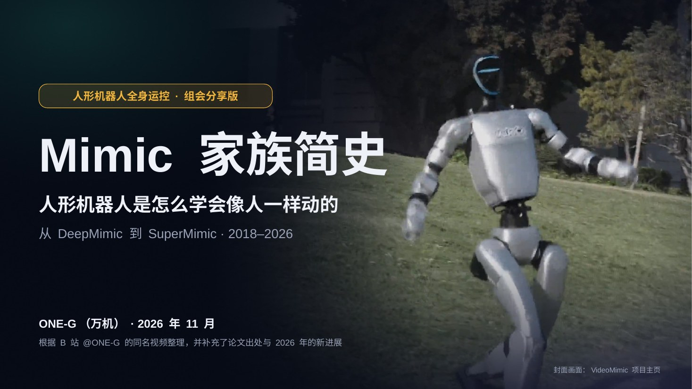
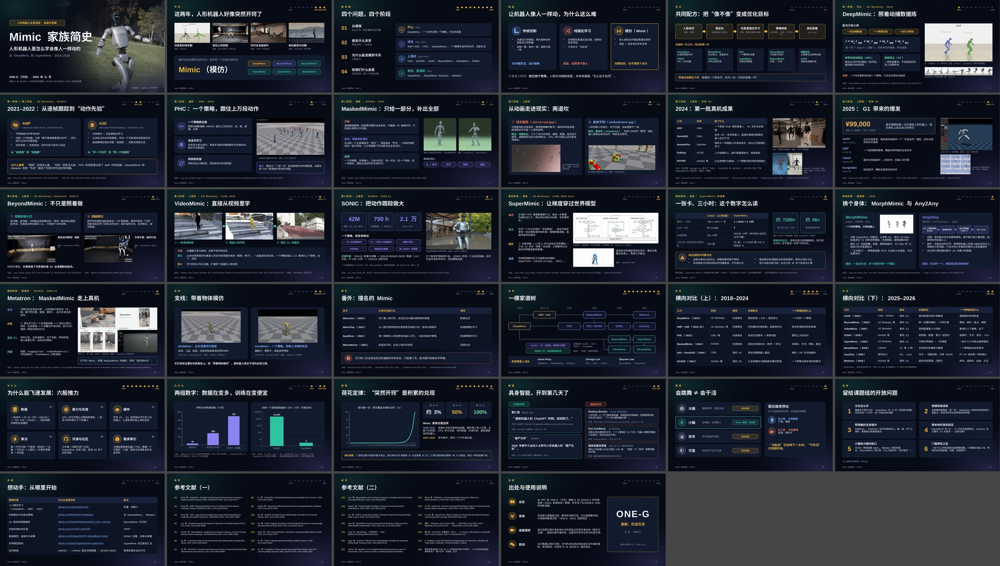
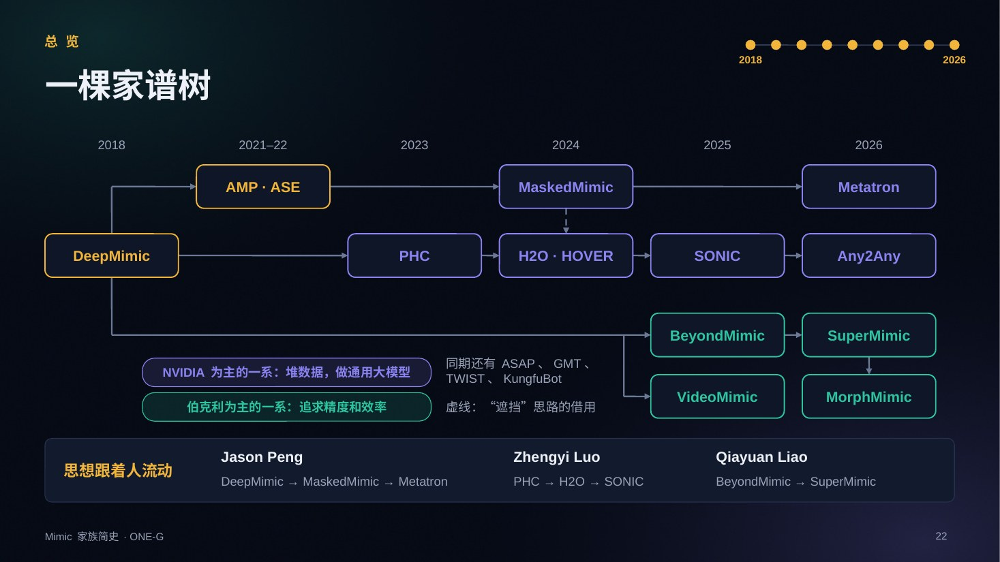

# Mimic 家族简史：人形机器人是怎么学会像人一样动的

从 DeepMimic 到 SuperMimic（2018–2026）｜人形机器人全身运控科普｜ONE-G（万机）

这是 B 站 UP 主 “ONE-G万机” 的科普视频[《Mimic 家族简史》](https://www.bilibili.com/video/BV1zs486QEN7/)的配套 PPT。它把这几年名字里带 “Mimic” 的人形机器人全身运控方法理了一遍：从哪来，彼此什么关系，为什么能发展到今天，又留下了哪些开放问题。

## 下载

- **PPT**：[Mimic家族简史_组会分享版.pptx](Mimic家族简史_组会分享版.pptx)（34 页，16:9，约 20 MB）
- **视频**：[B 站《Mimic 家族简史》](https://www.bilibili.com/video/BV1zs486QEN7/)（UP 主：ONE-G万机，15 分 27 秒）

## PPT 里有什么

- 每页备注里有可以直接讲的讲稿
- 嵌入了 24 段演示视频，放映时自动循环播放，点一下可以暂停
- 每段画面都在页面上标了出处，末尾有带 arXiv 编号的参考文献
- 中文字体是微软雅黑，英文是 Arial

| 部分 | 页码 | 内容 |
| --- | --- | --- |
| 开场 | 1–3 | 现象，四个问题，四个阶段 |
| 缘起 | 4–5 | 为什么“像人一样动”这么难；整个家族共用的流水线 |
| 仿真时代 | 6–9 | DeepMimic、AMP / ASE、PHC、MaskedMimic |
| 走上真机 | 10–15 | 两道坎；H2O、HOVER、ASAP、BeyondMimic、VideoMimic、SONIC |
| 2026：更快、更通用 | 16–19 | SuperMimic、MorphMimic、Any2Any、Metatron |
| 支线与番外 | 20–21 | SkillMimic、InterMimic；撞名的 Mimic |
| 全景 | 22–26 | 家谱树，横向对比表，六股推力，两组数字 |
| 回望与展望 | 27–30 | 荷花定律，具身智能的两种声音，开放问题 |
| 资源与参考 | 31–34 | 上手资源，参考文献，出处与使用说明 |

## 预览

## 使用与引用

欢迎用于课题组分享、教学和交流，可以按需要修改。引用或转载请注明 **“ONE-G · Mimic 家族简史”**。

- ONE-G 原创内容的许可见 [LICENSE.md](LICENSE.md)
- PPT 里的演示视频和图片来自各论文的项目主页与开源仓库，版权归原作者，逐条出处见 [CREDITS.md](CREDITS.md)

## 参考文献

**主线**

1. Peng 等. DeepMimic. SIGGRAPH 2018. [arXiv:1804.02717](https://arxiv.org/abs/1804.02717)
2. Peng 等. AMP: Adversarial Motion Priors. SIGGRAPH 2021. [arXiv:2104.02180](https://arxiv.org/abs/2104.02180)
3. Peng 等. ASE: Adversarial Skill Embeddings. SIGGRAPH 2022. [arXiv:2205.01906](https://arxiv.org/abs/2205.01906)
4. Luo 等. Perpetual Humanoid Control (PHC). ICCV 2023. [arXiv:2305.06456](https://arxiv.org/abs/2305.06456)
5. Tessler 等. MaskedMimic. SIGGRAPH Asia 2024. [arXiv:2409.14393](https://arxiv.org/abs/2409.14393)
6. He 等. H2O. 2024. [arXiv:2403.04436](https://arxiv.org/abs/2403.04436)
7. He 等. OmniH2O. 2024. [arXiv:2406.08858](https://arxiv.org/abs/2406.08858)
8. Fu 等. HumanPlus. 2024. [arXiv:2406.10454](https://arxiv.org/abs/2406.10454)
9. Cheng 等. ExBody. 2024. [arXiv:2402.16796](https://arxiv.org/abs/2402.16796)
10. He 等. HOVER. 2024. [arXiv:2410.21229](https://arxiv.org/abs/2410.21229)
11. He 等. ASAP. 2025. [arXiv:2502.01143](https://arxiv.org/abs/2502.01143)
12. Chen 等. GMT. 2025. [arXiv:2506.14770](https://arxiv.org/abs/2506.14770)
13. Ze 等. TWIST. 2025. [arXiv:2505.02833](https://arxiv.org/abs/2505.02833)
14. Xie 等. KungfuBot. NeurIPS 2025. [arXiv:2506.12851](https://arxiv.org/abs/2506.12851)
15. Liao 等. BeyondMimic. 2025. [arXiv:2508.08241](https://arxiv.org/abs/2508.08241)
16. Allshire 等. VideoMimic. CoRL 2025. [arXiv:2505.03729](https://arxiv.org/abs/2505.03729)
17. Luo 等. SONIC. 2025. [arXiv:2511.07820](https://arxiv.org/abs/2511.07820)
18. Liao 等. SuperMimic. CoRL 2026 Oral. [arXiv:2610.28480](https://arxiv.org/abs/2610.28480) · [项目页](https://supermimic.github.io/)
19. Yang 等. MorphMimic（开源项目）. 2026. [github.com/lzyang2000/morphmimic](https://github.com/lzyang2000/morphmimic)
20. Yang 等. Any2Any. 2026. [arXiv:2605.23733](https://arxiv.org/abs/2605.23733)
21. Tessler 等. Metatron. 2026. [项目页](https://research.nvidia.com/labs/par/projects/metatron/)

**支线与番外**

22. Wang 等. SkillMimic. CVPR 2025. [arXiv:2408.15270](https://arxiv.org/abs/2408.15270)
23. Xu 等. InterMimic. CVPR 2025. [arXiv:2502.20390](https://arxiv.org/abs/2502.20390)
24. Fussell 等. SuperTrack. SIGGRAPH Asia 2021.
25. 撞名的 Mimic：MimicGen [arXiv:2310.17596](https://arxiv.org/abs/2310.17596) · MimicPlay [arXiv:2302.12422](https://arxiv.org/abs/2302.12422) · EgoMimic [arXiv:2410.24221](https://arxiv.org/abs/2410.24221) · MimicMotion [arXiv:2406.19680](https://arxiv.org/abs/2406.19680)

**观点与数据**

26. 黄仁勋. CES 2025 主题演讲. 2025 年 1 月.
27. R. Brooks. Why Today's Humanoids Won't Learn Dexterity. 2025 年 9 月. [rodneybrooks.com](https://rodneybrooks.com/why-todays-humanoids-wont-learn-dexterity/)
28. K. Goldberg. Good Old-Fashioned Engineering Can Close the 100,000-Year "Data Gap" in Robotics. Science Robotics, 2025 年 8 月. doi:10.1126/scirobotics.aea7390
29. 国家发展改革委 2025 年 11 月新闻发布会文字实录.

**想动手，可以从这些仓库开始**

- 入门模仿学习（DeepMimic、AMP、ASE）：[xbpeng/MimicKit](https://github.com/xbpeng/MimicKit)
- 仿真角色与生成式策略（MaskedMimic、Metatron）：[NVlabs/ProtoMotions](https://github.com/NVlabs/ProtoMotions)
- G1 真机高质量跟踪（BeyondMimic）：[HybridRobotics/whole_body_tracking](https://github.com/HybridRobotics/whole_body_tracking)
- 仿真到真机的补偿：[LeCAR-Lab/ASAP](https://github.com/LeCAR-Lab/ASAP)
- 基础模型、遥操作与部署（SONIC）：[NVlabs/GR00T-WholeBodyControl](https://github.com/NVlabs/GR00T-WholeBodyControl)
- 世界模型路线（SuperMimic 社区复现汇总）：[DiaoOrg/awesome-supermimic](https://github.com/DiaoOrg/awesome-supermimic)

## 勘误与反馈

论文数据以原文为准，文中的对比结论来自各论文作者的报告。发现错误，欢迎提 Issue，或到 [B 站视频](https://www.bilibili.com/video/BV1zs486QEN7/)的评论区留言。

如果你是某段演示画面的作者，希望调整署名或撤下画面，请提 Issue，我们会尽快处理。
